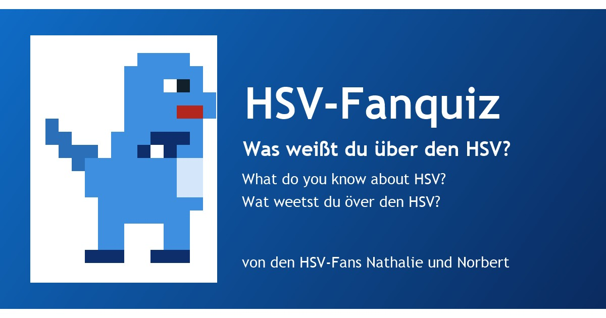

# HSV-Fanquiz

**Von den HSV-Fans Nathalie und Norbert** (inoffizielles Fan-Projekt)

**Datei:** `index.html` (eine Datei, offline lauffähig, Version 1.3.2, Stand 23.10.2026). Einfach im Browser öffnen oder auf einem Webserver ablegen.

> **Veröffentlichung:** GitHub-Repository `hsv` (Benutzer `nosz`), Adresse `https://nosz.github.io/hsv/`. Alle Dateien der Liste unten ins Hauptverzeichnis des Repositories legen (ohne Unterordner), GitHub Pages auf den Hauptzweig stellen. Bei anderer Adresse in `index.html` (canonical, og:url, og:image, twitter:image, `SHARE_URL`) und in dieser README anpassen.

## Inhalt
Fan-Quiz mit 7 Spieltagen, Humor, Zertifikaten und Personalisierung, in **Deutsch, Englisch und Plattdeutsch** (Umschalter oben, wird gespeichert).

| Nr. | Spieltag | Fragen |
|---|---|---|
| 1 | Blitzstart: 1887 in 60 Sekunden | 2 |
| 2 | Die Meistermaschine | 2 |
| 3 | Legenden: Uns Uwe & Co. | 4 |
| 4 | Europa: Athen 1983 und andere Abende | 4 |
| 5 | Volkspark & Mitglieder: Zahlen zum Staunen | 4 |
| 6 | Spitznamen & Dino-Zeit | 4 |
| 7 | Bossrunde: Elfmeterschießen | 5 |

- **Kopfzeile:** "von den HSV-Fans Nathalie und Norbert" (Deutsch, Englisch, Plattdeutsch), ebenso auf jedem Zertifikat und in der Fußzeile.
- **Fanblock-Spruch & Fakt:** Karte auf der Startseite mit 16 Sprüchen und Fakten (Gags von Nathalie und Norbert plus belegte Fakten von hsv.de), Knopf "Noch einer!" zeigt den nächsten.
- **Spielmechanik:** 10 Tore je richtiger Antwort, 1 bis 3 Sterne je Spieltag, 5 Ränge von "Bankdrücker" bis "Bundesliga-Dino", Konfetti, Hell- und Dunkelmodus.
- **Zertifikat teilen:** Knopf „Zertifikat den Freunden zeigen“ über „Nächster Spieltag“ auf der Ergebnisseite, Text je Spieltag mit Link zur App.
- **Zertifikate:** je Spieltag ein "Fanblock-Zertifikat", zum Abschluss das "Dino-Meister-Zertifikat" (PNG speichern oder drucken). Unterschrieben "Nathalie & Norbert (inoffiziell)".
- **Dino abschalten:** Dino-Symbol 🦖 oben in der Kopfzeile, ein Klick blendet ihn dauerhaft aus, ein zweiter holt ihn zurück.
- **Dino:** Ab und zu läuft ein kleiner blauer Pixel-Dino mit dunkelblauem Schal über den Bildschirm (rein dekorativ, nicht klickbar, aus bei „Bewegung reduzieren“). Der Name passt zum Spitznamen „Bundesliga-Dino“. Er spricht immer Plattdeutsch (egal welche Sprache eingestellt ist), stellt sich beim allerersten Auftritt lustig vor, macht Witze über andere Vereine (immer respektvoll) und fragt nach dem Namen: ohne Namen immer drängender (höchstens sechsmal), mit Namen kommt ein kurzer Witz und „Ik kaam wedder, <Name>!“. Test mit Adresse `?lauf=witz` (weitere: `name`, `gruss`, `stammtisch`, `brezn`, `tor`, `fass`, `karriere` u. a.; die Auftrittsnamen stammen aus dem Vorgängerprojekt).
- **Installieren-Knopf, PWA:** installierbar, läuft offline, Update-Hinweis. Dateien (alle ins Hauptverzeichnis): `index.html`, `manifest.webmanifest`, `sw.js`, `icon-192.png`, `icon-512.png`, `icon-maskable-512.png`, `favicon.png`, `favicon.svg`, `apple-touch-icon.png`, `hsv_vorschau.jpg`. Bei jeder neuen Version `VERSION` in `index.html` **und** `sw.js` gemeinsam erhöhen.

## Marke und Look
Farben aus zwei Screenshots von hsv.de geschätzt (Blau der Kopfzeile, Weiß, Dunkelblau/Schwarz), nicht aus dem Quelltext der Seite: Hauptblau `#0b5cad`, Dunkelblau `#0d2d6b`, dazu Gold nur für Sterne. Es werden **kein Vereinswappen (Raute), keine Logos, keine Spielerfotos und keine kopierten Texte** verwendet. Der Dino ist selbst gezeichnet (Pixelgrafik, 13 x 16, in den Blautönen des Vereins). Die Seite ist ein inoffizielles Fan-Projekt ohne Verbindung zum Hamburger SV.

## Quellen (ausschließlich hsv.de, abgerufen 18.10.2026)
- Die Geschichte des HSV: https://www.hsv.de/unser-hsv/historie/die-geschichte-des-hsv
- So gründete sich der HSV: https://www.hsv.de/news/so-gruendete-sich-der-hsv
- Volksparkstadion: https://www.hsv.de/volkspark/volksparkstadion
- Verein: https://www.hsv.de/unser-hsv/verein/verein
- Startseite: https://www.hsv.de/

Alle Fakten in Lektionen, Fragen und Sprüchen stammen von diesen Seiten. Die Witze des Dinos sind erfunden (Fan-Humor); wo sie Fakten nennen (z. B. 77.600 Zuschauer 1961, 4:4 gegen Juventus 2000), stehen die Fakten auf hsv.de.

## Bekannte Grenzen
- hsv.de nennt zwei Gründungsdaten (29.09.1887 für den SC Germania, 01.06.1888 für den Hamburger Fußball-Club). Das Quiz nennt beide und fragt nur das offizielle Datum (1887) ab. Beim Umzug ins Volksparkstadion nennen die Seiten 1963; die Namensrückgabe an den Verein erfolgte laut Seite im Juli 2015.
- Die Seite zum Stadion nennt eine Genehmigung für mehr als 60.000 Plätze (Meldung vom 8. September 2026) und „bis zu 57.000“ Menschen bei Veranstaltungen; Zahlen ändern sich laufend. Mitglieder: „150.000“ (Sommer 2026, laut hsv.de).
- Die Seite „Die Geschichte des HSV“ nennt den Namen „Rothosen“ nur in der Liste der Spitznamen; ein Maskottchen steht auf hsv.de nicht. Der Dino ist eine Erfindung dieses Fan-Projekts.
- Die Texte auf Plattdeutsch sind spielerisch gemeint (Hamburger Platt, keine Rechtschreibnorm); Platt-Profis dürfen gern korrigieren. Die englischen Texte sollten Muttersprachler gegenlesen.
- Vor einer öffentlichen Veröffentlichung Marken- und Stil-Anlehnung mit Management/Legal klären.

## Tests
Die Testsuite (`tests/index.html`, über einen lokalen Webserver öffnen) stammt aus dem FCBAYERN-Projekt und ist auf HSV angepasst (Texte, Sprachen, Schlüssel). Stand und Ergebnis siehe Changelog.

## Changelog
- 1.3.2 (23.10.2026): Im Fuß steht jetzt „Website Design by Norbert“ statt „Created by Norbert“ (auffälliger Knopf unter der Version, der ganze Text ist der Link auf https://nosz.github.io/norbert-szpak/).
- 1.3.1 (20.10.2026): Im Fuß der Startseite steht neben der Version statt des Datums der Link „Created by Norbert“ (gleiches Design, öffnet https://nosz.github.io/norbert-szpak in einem neuen Tab).
- 1.3.0 (18.10.2026): **Dino spricht in der eingestellten Sprache** (Deutsch, Englisch oder Plattdeutsch, alle Texte in jeder Sprache; bei Sprachwechsel meldet er sich gleich neu). **Teilen-Knopf überall und am auffälligsten:** auf der Ergebnisseite, auf jeder Zertifikat-Seite (auch Meister), in der Übersicht der Zertifikate bei jedem Eintrag und auf den Lektionskarten. Groß, gefüllt, ganz oben, mit dem Teilen-Symbol aus der Kopfzeile; „Nächster Spieltag“ darunter, „Als Bild speichern“ und „Drucken“ klein. Beschriftung: „Zertifikat den Freunden zeigen (Angeben erlaubt)“. **Urkunde:** Sprache immer wie im Menü, Kasten mit Fragen und Antworten (zu lange Texte werden kleiner und umbrochen, nie einfach abgeschnitten), Fußzeile mit dem Hinweis steht im Rahmen und ist gut lesbar.
- 1.2.0 (18.10.2026): Dino ist jetzt blau (Figur, Icons, Favicon, Vorschaubild). Urkunden: Kasten „Das habe ich gewusst“ mit allen Fragen des Spieltags und der richtigen Antwort (zu lange Texte: kleinere Schrift, dann gekürzt), Meister-Zertifikat mit den sieben Spieltagen, goldene Zierlinie. Zertifikat teilen: Nach einem bestandenen Quiz steht über „Nächster Spieltag“ der Knopf „Zertifikat den Freunden zeigen (Angeben erlaubt)“. Er öffnet das Teilen-Menü des Geräts mit dem Zertifikat als PNG und einem Text samt Link zur App (https://nosz.github.io/hsv/). Der Text ist humorvoll, aber sachlich und hängt vom Spieltag ab (sieben Fassungen plus eine für das Dino-Meister-Zertifikat), mit Ergebnis („x von y richtig“) und in der gewählten Sprache. Die Urkunde führt jetzt die Quiz-Fragen des Spieltags mit der richtigen Antwort auf („Das habe ich gewusst“), das Dino-Meister-Zertifikat die sieben Spieltage. Kann das Gerät keine Bilder teilen, wird nur Text mit Link geteilt, ohne Teilen-Menü öffnet sich ein Fenster mit WhatsApp, E-Mail und „Link kopieren“.
- 1.1.0 (18.10.2026): Dino lässt sich abschalten: Dino-Symbol 🦖 in der Kopfzeile (neben Teilen und Hell/Dunkel). Ein Klick blendet Dino sofort und dauerhaft aus (im Browser gespeichert, auch nach Neuladen), ein Hinweis erklärt, wie er wiederkommt; erneuter Klick holt ihn zurück. Das Symbol ist durchgestrichen, solange Dino aus ist, und hat Beschriftung und Zustand (aria-pressed) für Screenreader.
- 1.0.0 (18.10.2026): Neues Projekt auf Basis des FCBAYERN-Fan-Quiz (Version 1.10.0): HSV-Inhalte ausschließlich von hsv.de, Farben nach den hsv.de-Screenshots (Blau/Weiß), kleiner Dino namens Dino statt des kleinen Bayern (stellt sich zu Beginn lustig vor, spricht Plattdeutsch), Plattdeutsch statt Bairisch, neue Autorenzeile „von den HSV-Fans Nathalie und Norbert“, neue Icons und Vorschau.
